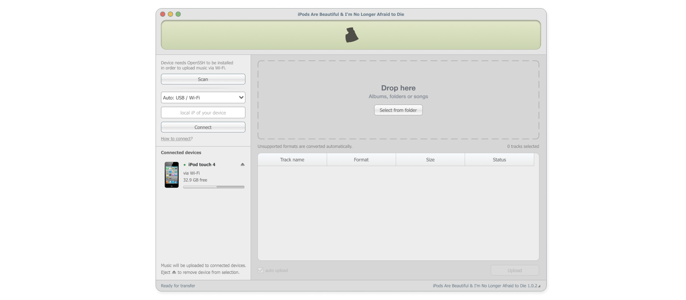

# iPods Are Beautiful & I'm No Longer Afraid to Die

A Windows app for adding local music to the built-in Music app on an iPod touch or iPhone, over USB or Wi-Fi.

The code is AI-slopped. The design was made by hand, with love.



## Download

[Download for Windows x64 (.exe)](https://github.com/metalstress/ipods-are-beautiful/releases/latest/download/iPods-Are-Beautiful-Windows-x64.exe)

Run the downloaded executable. Python, Rust and build tools are not needed. A [ZIP with the executable and notices](https://github.com/metalstress/ipods-are-beautiful/releases/latest/download/iPods-Are-Beautiful-Windows-x64.zip) is also available.

Apple device drivers and the device setup below are still required.

## What works in 1.1.1

- Drag and drop songs, folders or albums.
- Convert unsupported audio to ALAC. Compatible MP3, AAC and ALAC files pass through without re-encoding.
- Transfer artwork and tags into the device's Music library.
- Keep compilation tracks together using release IDs and a shared album artist. Conflicting release tags are left unchanged.
- Look up missing import artwork through Deezer and MusicBrainz / Cover Art Archive; keep existing covers.
- Fill missing artwork on local iPhone albums in the background while idle. Uploads and library editing take priority.
- Upload immediately with **auto upload**, or collect a queue and press **Upload**.
- Show imported tracks, transferred data, speed and device storage.
- Check for existing tracks before importing. Keep the original files on the PC.
- Eject the selected device and stop the remaining queue after the current operation finishes.
- Browse albums, artists, songs and playlists on a selected device.
- Delete songs or albums; change artwork, genre and release year.
- Create, rename and delete ordinary playlists. Add selected songs, or edit a playlist's contents before pressing **Done**.

## Tested

Windows 11 x64. Hardware testing was limited to these two devices:

| Device | System | Checked |
| --- | --- | --- |
| iPod touch 4 | iOS 6.1.6, jailbroken | USB and Wi-Fi imports into Music, conversion, playback checks and duplicate cleanup. |
| iPhone 16 Pro | iOS 27.0 | USB and Wi-Fi imports, playback checks, repeat-import detection and a full nine-track 24-bit/96 kHz FLAC album over Wi-Fi. |

The iPhone album import was checked against the device catalogue and stored files. This does not mean every imported track was listened to end to end.

For **1.1.1**, 157 application tests and 3 additional Music protocol tests passed on November 20, 2026. The standalone executable also passed packaging checks without Python on PATH. The unchanged signer previously passed 4 upstream vector tests. Commands, hardware results and remaining gaps are in [docs/testing.md](docs/testing.md).

## Not supported or not tested

- iPod Classic: no transfer backend yet. Its image in the design is a placeholder.
- Other iPhones: currently rejected by the device-model check. Other iOS versions have not been validated.
- Simultaneous uploads to multiple devices.
- DRM files and streaming catalogue downloads; editing smart, system or cloud playlists.
- Clean Windows installations, Windows 10, macOS and Linux have not been tested.
- Not every input format or possible tag combination has been tested on hardware.

This is a personal prototype. Initial device setup is manual.

## Library management

The [native library backend](docs/library-api.md) supports both tested devices. Playlist creation, adding without duplicates, renaming, removing members, clearing and deletion passed hardware checks over USB. Create, add and delete also passed over Wi-Fi. Song records and unrelated playlists were compared before/after. The interface has automated interaction checks; visual review is left to the user.

Compilation regrouping was verified on the iPhone. Missing-cover lookup was checked against the live artwork service; importing a new track with that artwork has not been separately tested on hardware.

Background artwork repair installed a missing cover on eleven existing iPhone songs over Wi-Fi. A second headless check correctly skipped the repaired album.

## Device setup

**iPhone:** install Apple's device drivers, connect by USB and trust the PC first. Wi-Fi requires an existing pairing record, wireless sync enabled and both devices on the same local network. No jailbreak or OpenSSH is needed.

**iPod touch:** requires iOS 6.1.6, a jailbreak, OpenSSH and Cycript. Configure SSH key authentication and a pinned host key in `%LOCALAPPDATA%\iMetal\settings.json`; an example is in [docs/touch-settings.example.json](docs/touch-settings.example.json). The source checkout does not include the optional Cycript bootstrap packages.

Settings, transfer journals and cache stay under `%LOCALAPPDATA%\iMetal`. Pairing records, private SSH keys, device backups and music files are not part of this repository.

## Run from source

Requires Python 3.13, Rust and the MSVC C++ build tools. In PowerShell, from the repository root:

```powershell
py -3.13 -m venv .venv
.\.venv\Scripts\python.exe -m pip install -r imetal/requirements.txt
cargo build --release --manifest-path modern-ios/signer/Cargo.toml
Copy-Item modern-ios/signer/target/release/ipods-music-signer.exe imetal/resources/
.\.venv\Scripts\python.exe imetal/app.py
```

Create a folder-based Windows build with `.\.venv\Scripts\python.exe imetal/build.py`, or add `--onefile` for a standalone executable.

## Projects used

- [rustunes](https://github.com/fbiba/rustunes) — native Music protocol research and the original fixed-profile signer. Pinned at `057ee8fc9c9da65795a6f14497fc408c2fe23c76`; the required source and test vectors are vendored.
- [libipodimport](https://github.com/H2CO3/libipodimport) — reference for the iOS 6 StoreServices import sequence.
- [pymobiledevice3](https://github.com/doronz88/pymobiledevice3) — paired iPhone services over USB and Wi-Fi.
- [PySide6 / Qt](https://doc.qt.io/qtforpython-6/), [Paramiko](https://github.com/paramiko/paramiko), [Mutagen](https://github.com/quodlibet/mutagen), [FFmpeg](https://ffmpeg.org/), [imageio-ffmpeg](https://github.com/imageio/imageio-ffmpeg) and [Pillow](https://github.com/python-pillow/Pillow) — interface, SSH, audio metadata, conversion and rendering.
- [Cycript](https://www.cycript.org/) and [SQLite](https://sqlite.org/) — the legacy device bridge.

Licences and asset credits are listed in [THIRD_PARTY.md](imetal/THIRD_PARTY.md).
