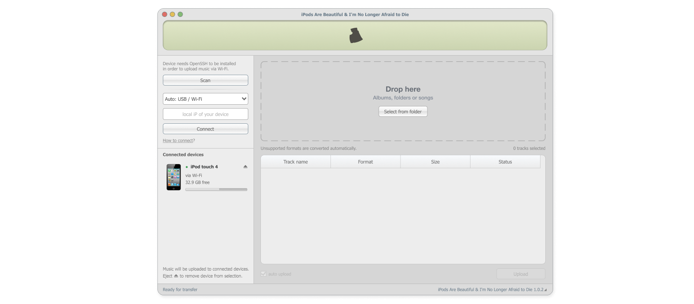

# iPods Are Beautiful & I'm No Longer Afraid to Die

A Windows app for adding local music to the built-in Music app on an iPod touch or iPhone, over USB or Wi-Fi.

The code is AI-slopped. The design was made by hand, with love.



## What works

- Drag and drop songs, folders or albums.
- Convert unsupported audio to ALAC. Compatible MP3, AAC and ALAC files pass through without re-encoding.
- Transfer artwork and tags into the device's Music library.
- Upload immediately with **auto upload**, or collect a queue and press **Upload**.
- Show imported tracks, transferred data, speed and device storage.
- Check for existing tracks before importing. Keep the original files on the PC.
- Eject the selected device and stop the remaining queue after the current operation finishes.

## Tested

Version **1.0.3**, Windows 11 x64. Hardware testing was limited to these two devices:

| Device | System | Checked |
| --- | --- | --- |
| iPod touch 4 | iOS 6.1.6, jailbroken | USB and Wi-Fi imports into Music, conversion, playback checks and duplicate cleanup. |
| iPhone 16 Pro | iOS 27.0 | USB and Wi-Fi imports, playback checks, repeat-import detection and a full nine-track 24-bit/96 kHz FLAC album over Wi-Fi. |

The iPhone album import was checked against the device catalogue and stored files. This does not mean every imported track was listened to end to end.

**52 Python tests and 4 Rust signer tests passed** on November 4, 2026. They cover conversion, metadata, queue behaviour, cancellation, progress, discovery, pairing, interrupted imports, backend communication and the Music protocol. The signer uses upstream test vectors. Commands and hardware-test details are in [docs/testing.md](docs/testing.md).

## Not supported or not tested

- iPod Classic: no transfer backend yet. Its image in the design is a placeholder.
- Other iPhones: currently rejected by the device-model check. Other iOS versions have not been validated.
- Simultaneous uploads to multiple devices.
- DRM files, streaming catalogue downloads, playlist editing or general library management.
- Clean Windows installations, Windows 10, macOS and Linux have not been tested.
- Not every input format or possible tag combination has been tested on hardware.

This is a personal prototype. Initial device setup is manual.

## Device setup

**iPhone:** install Apple's device drivers, connect by USB and trust the PC first. Wi-Fi requires an existing pairing record, wireless sync enabled and both devices on the same local network. No jailbreak or OpenSSH is needed.

**iPod touch:** requires iOS 6.1.6, a jailbreak, OpenSSH and Cycript. Configure SSH key authentication and a pinned host key in `%LOCALAPPDATA%\iMetal\settings.json`; an example is in [docs/touch-settings.example.json](docs/touch-settings.example.json). The source checkout does not include the optional Cycript bootstrap packages.

Settings, transfer journals and cache stay under `%LOCALAPPDATA%\iMetal`. Pairing records, private SSH keys, device backups and music files are not part of this repository.

## Run from source

Requires Python 3.13, Rust and the MSVC C++ build tools. In PowerShell, from the repository root:

```powershell
py -3.13 -m venv .venv
.\.venv\Scripts\python.exe -m pip install -r imetal/requirements.txt
cargo build --release --manifest-path modern-ios/signer/Cargo.toml
Copy-Item modern-ios/signer/target/release/ipods-music-signer.exe imetal/resources/
.\.venv\Scripts\python.exe imetal/app.py
```

Create a Windows build with `.\.venv\Scripts\python.exe imetal/build.py`.

## Projects used

- [rustunes](https://github.com/fbiba/rustunes) — native Music protocol research and the original fixed-profile signer. Pinned at `057ee8fc9c9da65795a6f14497fc408c2fe23c76`; the required source and test vectors are vendored.
- [libipodimport](https://github.com/H2CO3/libipodimport) — reference for the iOS 6 StoreServices import sequence.
- [pymobiledevice3](https://github.com/doronz88/pymobiledevice3) — paired iPhone services over USB and Wi-Fi.
- [PySide6 / Qt](https://doc.qt.io/qtforpython-6/), [Paramiko](https://github.com/paramiko/paramiko), [Mutagen](https://github.com/quodlibet/mutagen), [FFmpeg](https://ffmpeg.org/), [imageio-ffmpeg](https://github.com/imageio/imageio-ffmpeg) and [Pillow](https://github.com/python-pillow/Pillow) — interface, SSH, audio metadata, conversion and rendering.
- [Cycript](https://www.cycript.org/) and [SQLite](https://sqlite.org/) — the legacy device bridge.

Licences and asset credits are listed in [THIRD_PARTY.md](imetal/THIRD_PARTY.md).
